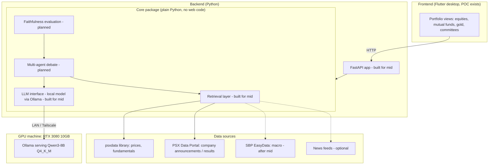
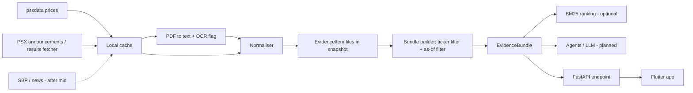
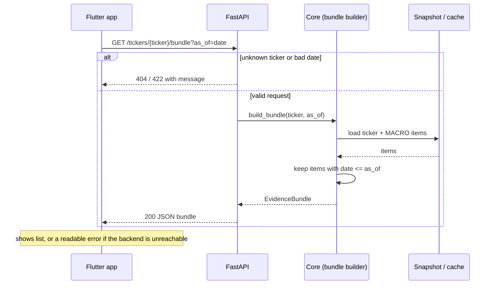
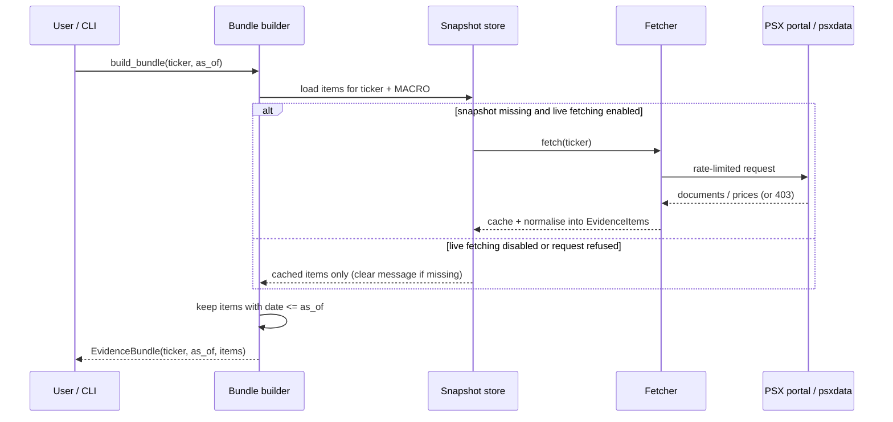

# Mizan: Full Project Context for the FYP-1 Mid Report

Prepared 2026-10-15, the day before the FYP-1 Mid evaluation (2026-10-16). Updated the same evening: SBP deferred
to after the mid; FastAPI backend and UI connection added to the mid scope.
Purpose: give the report writer every piece of project context gathered so far, in one place, mapped to what the
FYP-1 Mid rubric (Form 2 demo, Form 3 report) grades.

---

## 0. How to read this file

Every section is tagged with how certain its content is. Keep the tags in mind while writing; do not upgrade a
"proposal" or "draft" item to "done" in the report.

| Tag | Meaning |
|---|---|
| **[CONFIRMED]** | Decided or verified by the team (date given where known). Safe to state as fact. |
| **[PROPOSAL]** | From the accepted proposal or the 2026-09-14 review of it. Check the wording against the actual proposal document before copying; some of it is being revised. |
| **[REVISING]** | Known to be changing. Describe as "being revised" or leave out until settled. |
| **[DRAFT]** | Written here as a starting point (e.g. requirements). The team must review and own it before it goes in the report. |
| **[FILL IN]** | Needs a fact only the team has (names, results, dates, numbers from the repo). |

Two rules from the rubric that shape everything below:
- Supervisors pick a paragraph and ask the author to explain it without reading. Write sections you can defend in your own words. Polished generic text is a listed red flag ("Generic/GenAI R&D text" leads to a mandatory rewrite).
- Diagrams must match the current code. Diagrams with no code behind them are capped at 50% of design marks.

---

## 1. Project identity

| Item | Value |
|---|---|
| Project name | Mizan **[CONFIRMED]** |
| Full title | Faithful multi-agent portfolio management (working title; use the title on the accepted proposal) **[FILL IN: exact title]** |
| Institution | FAST NUCES, Islamabad campus, Department of Computer Science **[CONFIRMED]** |
| Programme / stage | BS Computer Science, Final Year Project, FYP-1 (7th semester); project continues through FYP-2 (8th semester) **[CONFIRMED]** |
| Team | 3 members **[CONFIRMED]**: Muhammad Isam (23I-0735, Section B); **[FILL IN: member 2 name, roll no.]**; **[FILL IN: member 3 name, roll no.]** |
| Supervisor | **[FILL IN]** |
| Current gate | FYP-1 Mid: formative, supervisor-only, 20% of FYP-1, around Week 8 **[CONFIRMED]** |
| Mid evaluation date | 2026-10-16 **[CONFIRMED]** |
| Governing documents | BS-FYP-Handbook-2026 (DRAFT); FYP-1 Mid Evaluation Guidelines & Rubrics (Form 2, Form 3) **[CONFIRMED]** |
| Status of proposal | Proposal defense accepted **[CONFIRMED]** |
| Commercial intent | Academic project for now (7th and 8th semesters); team wants to keep the option to commercialise later **[CONFIRMED]** |

### Grading gates (from the handbook) **[CONFIRMED]**

| Gate | When | Evaluator | Weight |
|---|---|---|---|
| Proposal Defense | FYP-1 Week 4 | Panel + supervisor | 30% (done, passed) |
| **FYP-1 Mid** | **FYP-1 Week 8** | **Supervisor only** | **20%** |
| FYP-1 Final | FYP-1 final week | Panel (demo) + supervisor (report) | 50% |
| FYP-2 Mid / Job Fair | FYP-2 Week 8 | Panel + supervisor | 50% (highest stakes) |
| FYP-2 Final | FYP-2 final week | Supervisor only | 50% |

Handbook constraints that matter for Mizan:
- About **45% implementation** is expected by FYP-1 Final.
- **Score cap:** if the core feature is mainly a ready-made API/tool/template with no meaningful added work, core implementation marks are capped (50%). Mizan's defence is the local, self-hosted model stack and the team's own retrieval, debate and faithfulness logic.
- **Responsible Tool/GenAI Use rubric (levels L1 to L4):** AI-usage logs must be kept continuously, not reconstructed later.

---

## 2. One-paragraph summary **[CONFIRMED, wording yours to adapt]**

Mizan is a portfolio management system for Pakistani investors, built around the Pakistan Stock Exchange (PSX).
The app tracks and manages several asset classes (PSX equities, mutual funds, gold, committees, and others). For the
equity side, a set of local large-language-model (LLM) agents analyses dated market evidence (prices, company
announcements, macro indicators) and debates towards a decision. The research contribution is a **faithfulness
evaluation layer**: it tests whether the agents' stated reasons actually drive their decisions, instead of the agents
producing plausible explanations or agreeing with each other on the surface. PSX is the testbed; the faithfulness
evaluation is the contribution.

---

## 3. Product scope

### 3.1 Whole system **[CONFIRMED]**
- Mizan is a **portfolio management app**, not only a debate system.
- Asset classes mentioned by the team: PSX equities, mutual funds, gold, committees, and others. **[FILL IN: final list, and what "committees" covers]**
- **AI scope:** the AI agents make decisions only on part of the portfolio (currently understood to be PSX equities). The app still manages the other asset classes without AI decisions. **[FILL IN: confirm AI scope and what "manage" means for non-AI assets: tracking, valuation, P&L, allocation, reminders?]**
- A **Flutter desktop frontend proof of concept (POC)** already exists. The portfolio features currently live there.
- A separate **Python backend** holds the retrieval, AI and evaluation logic: a plain-Python core package plus a **FastAPI** application that exposes it over HTTP. The Flutter app calls the API.

### 3.2 Scope for FYP-1 Mid **[CONFIRMED, updated 2026-10-15 evening]**
The mid shows three things:
1. **The PSX retrieval layer** (data collection, normalisation into dated evidence, as-of evidence bundles). Reported done; verify against tests.
2. **The FastAPI backend connected to the Flutter UI.** Required: without the UI connection, marks are lost.
3. **Local model deployment** (Qwen3-8B served locally through Ollama on the GPU machine, returning structured output), with its status available through the API.

Deferred until after the mid: SBP/macro data. Out of scope for the mid: the multi-agent debate and the faithfulness
layer implementation. These are described in the report as design and plan, not as built.

### 3.3 Work division **[CONFIRMED 2026-10-15]**

| Member | Responsibility |
|---|---|
| Muhammad Isam | Retrieval layer, FastAPI backend **[confirm API owner]**, local model deployment |
| **[FILL IN: name]** | FYP-1 Mid report |
| **[FILL IN: name]** | Flutter side of the frontend-to-backend connection (calling the API, showing results) |

Rubric note: every member must be able to explain their own part, and commit history should show work from all
members. A member who cannot explain their module can trigger Form 11 (individual contribution adjustment).

---

## 4. Problem, motivation and research gap

### 4.1 Problem **[PROPOSAL]**
Multi-agent LLM systems are increasingly used for financial analysis and trading decisions. Their natural-language
explanations look convincing, but nothing guarantees that the explanation is the actual cause of the decision. In a
debate between agents, agents can converge on a conclusion while reasoning about different things, or change position
because of peer pressure rather than evidence. For an investor, an unfaithful explanation is worse than no
explanation, because it creates false confidence.

### 4.2 Specific failure mode targeted: the "consistency illusion" **[PROPOSAL]**
When agents debate, surface agreement can rise (contradiction rate falls) while the semantic similarity of their
reasoning also falls. The agents agree on the conclusion without reasoning about the same thing. This passes casual
inspection, which makes it more dangerous than visible disagreement. The proposal attributed this framing to Wang &
Yang (June 2026) and identified that it had not been tested in a financial multi-agent setting.
**[FILL IN: exact citation from the proposal]**

### 4.3 Research gap **[PROPOSAL, check against proposal]**
- Industrial and academic multi-agent finance systems (e.g. the JPMorgan multi-agent portfolio paper, FinRobot-style frameworks) focus on performance, not on whether the agents' explanations are faithful.
- Auditing work such as M-SAEA audits deployment and interaction risk broadly, not whether the debate is genuine.
- The novelty claim, as stress-tested in August 2026 against recent work (M-SAEA, CFMAD, FACT-E and others): the **combination** of cross-agent faithfulness testing, graded (magnitude) measurement of faithfulness, and continuous economic action output, applied to financial multi-agent debate architectures.
- PSX is under-studied in this literature, and its data access is itself a practical challenge (see Section 8).

### 4.4 Complex computing problem angle
The proposal mapped the project to the Seoul Accord complex computing problem characteristics (CCP mapping).
**[FILL IN: copy the CCP table from the proposal and update it if scope changed]**

---

## 5. The research contribution: faithfulness evaluation layer

This is the part of the project that is changing most. Report it carefully.

### 5.1 Current direction **[REVISING, confirmed in outline]**
- The team has adopted a **new base paper**: a study that uses **local LLMs**, **perturbation**, and **faithfulness metrics**. **[FILL IN: title, authors, year, venue, and the metrics it defines]**
- The research framing recorded in August 2026: an evaluation framework that tests the **causal faithfulness** of LLM agents' natural-language explanations through **counterfactual evidence perturbation** (change or remove a piece of evidence and measure how much the agent's output moves).
- Planned three-phase empirical arc:
  1. **Phase 1:** build a perturbation-and-measurement pipeline producing elasticity-style faithfulness coefficients (how strongly the decision responds to the evidence the agent claims to rely on).
  2. **Phase 2:** diagnose where and why faithfulness breaks down.
  3. **Phase 3:** propose a targeted fix informed by Phase 2.
- How the retrieval layer supports this: every evidence item has a stable ID and a publish date, so evidence can be removed or altered one item at a time, and agents can cite exactly which items they used. The retrieval layer is designed so these perturbation experiments are possible.

### 5.2 Design in the accepted proposal **[PROPOSAL, may be superseded by 5.1]**
Four frozen, non-LLM sub-scorers (non-LLM by design, because an LLM judging an LLM would be circular for the property being measured):
1. **Flip Scoring (EFR, CCR):** extends Lanham et al.'s counterfactual perturbation idea to every debate-round transition; distinguishes an *evidence flip* (position changed because of a newly cited fact) from a *conformity flip* (position changed with no new grounding).
2. **Evidence Grounding (EGS):** Jaccard token overlap plus exact numeric matching, checking that claims trace back to retrieved evidence.
3. **Cross-Agent Alignment (CARA-HYB, contradiction rate, semantic similarity):** DeBERTa-NLI plus embedding similarity; the direct instrument for the consistency illusion.
4. **Decision Consistency (R2C, C2A):** checks that the final verdict cites the best-grounded argument and that the stated action matches the verdict.

Other proposal elements to reconcile: the six-stage pipeline, the five-arm ablation design, and the fine-tuning
decision (a fresh LoRA pass on a clean base model rather than stacking on FinGPT). **[FILL IN from proposal]**

### 5.3 Known methodological issue to address **[CONFIRMED issue; resolution REVISING]**
- Hao et al. (May 2026), "Not All Flips Are Conformity", shows that raw answer-flip rates in multi-agent debate mix three mechanisms: spontaneous instability (an agent changes its answer on re-examination with no peer input), stance-induced conformity, and reasoning-induced persuasion. It also shows that even invalid peer reasoning can persuade.
- The proposal's EFR/CCR design had no **self-reflection control condition** (re-asking the same agent with no peer exposure), so it could not separate conformity from baseline instability.
- Options: add a cheap control condition, or state it as a limitation. The panel is likely to know this paper, so the report should address it explicitly either way. If the new perturbation-based method replaces flip scoring, explain that and how it handles instability (for example, repeated runs with the same seed or temperature to measure baseline variance).

### 5.4 What to say in the mid report
State plainly: the faithfulness method is being refined around the new base paper; the retrieval layer has been
designed to make perturbation experiments possible (stable evidence IDs, dates, as-of bundles); implementation of
the faithfulness layer is planned after the mid. This is honest and matches the agreed mid scope.

---

## 6. Literature (citation roles)

### 6.1 Papers reviewed on 2026-09-14 **[PROPOSAL; update with the new base paper]**

| Paper | Role in the report |
|---|---|
| **[NEW BASE PAPER, FILL IN]** | Primary method reference for the faithfulness layer (local LLMs, perturbation, metrics) |
| Hao et al. (May 2026), "Not All Flips Are Conformity" | Most directly relevant; motivates a control condition; must be addressed explicitly |
| JPMorgan multi-agent portfolio paper (EMNLP Industry 2025) | Closest industrial precedent: specialised agents for portfolio analytics, beats single-agent baselines; no faithfulness auditing |
| "From Tasks to Teams" / M-SAEA (ACL Findings 2026) | Risk-first auditing agent for financial multi-agent teams (10 probes, 4 layers); closest auditing comparison, but audits risk broadly rather than debate genuineness |
| "Agentic Trading" survey (arXiv 2605.19337) | 77-study evidence map; finds severe reproducibility problems (0 of 19 studies reach its top reproducibility tier); supports the rigour/reproducibility motivation |
| Bias-Aware Multi-Agent retail advisory paper | Targets sector/geographic concentration bias in LLM portfolios; adjacent axis (bias, not reasoning faithfulness) |
| Layered Chain-of-Thought (2025) | Single-model precursor of externally verified reasoning; light citation |
| SSRN review of interpretable ML/LLMs in finance | General motivation: regulatory explainability vs decision transparency |
| Lanham et al. | Origin of counterfactual perturbation tests of reasoning faithfulness |
| Wang & Yang (June 2026) | Source of the "consistency illusion" framing |
| Also stress-tested against: CFMAD, FACT-E | Novelty check **[FILL IN details]** |

**[FILL IN: full references in the required citation style, verified against the actual papers]**

### 6.2 Comparison table
The proposal had a six-block "prior research to our specific delta" table. Reuse it, add the new base paper, and add
a column showing what Mizan does differently. **[FILL IN from proposal]**

---

## 7. System architecture

### 7.1 Layers **[CONFIRMED structure; components beyond retrieval and model serving are planned, not built]**



Redraw this to match the repo exactly before submitting. Mark planned components visibly (dashed or greyed).

### 7.2 Repository layout (retrieval scope) **[CONFIRMED target; FILL IN: actual tree from repo]**
```
mizan/
  schemas.py      # EvidenceItem, EvidenceBundle (the contract)
  fetcher/        # automated PSX announcements / results fetcher (rate-limited, cached, switchable)
  data/           # psxdata price loader, pdf_extract.py, normalizer.py (SBP loader after the mid)
  retrieval/      # bundle.py (as-of filter), bm25.py, embeddings.py (only if needed)
api/              # FastAPI app for the Flutter frontend; no business logic
tests/            # core tests + API tests (FastAPI TestClient)
data/cache/       # git-ignored; raw PSX documents never committed
data/snapshots/   # local, untracked; a manifest is committed instead
docs/             # decisions.md, sources-and-compliance.md, status.md, ai_usage_log.md, plans
```

### 7.3 Interface contract **[CONFIRMED]**
The only interface between data components and the rest of the system:

**EvidenceItem**

| Field | Meaning |
|---|---|
| `id` | Stable, unique identifier (used for citation and perturbation) |
| `ticker` | Company symbol, or `"MACRO"` for market-wide items |
| `source` | Where it came from (e.g. PSX portal, psxdata, SBP) |
| `type` | Kind of evidence (e.g. price summary, financial result, announcement, macro indicator) |
| `date` | Publish date of the underlying information |
| `text` | Normalised text content |

**EvidenceBundle**

| Field | Meaning |
|---|---|
| `ticker` | Company the bundle is for |
| `as_of` | The "decision date"; only information available on or before it may appear |
| `items` | List of EvidenceItems |

**[FILL IN: any extra fields the code actually has]**

### 7.4 Hard rules enforced in code and tests **[CONFIRMED]**
1. **No look-ahead:** a bundle for `as_of` contains only items with `date <= as_of`. (A decision on 30 September must not see a 5 October headline; otherwise every experiment is contaminated.)
2. **Ticker isolation:** a ticker's bundle contains that ticker's items plus MACRO items only.
3. **Reproducibility:** runs use cached data and frozen snapshots; live fetching can be switched off.
4. **No raw PSX data in git;** cache is git-ignored; snapshots stay local with a committed manifest (source URLs, fetch date, item counts, content hashes, rebuild command).

### 7.5 Design decisions and why **[CONFIRMED]**
| Decision | Reason |
|---|---|
| Separate Python backend; Flutter is only a client | Keeps AI/retrieval logic testable and independent of the UI; FastAPI exposes it over HTTP |
| Core package has no web code; FastAPI app in a separate `api/` layer | Keeps logic testable without a server; the API stays thin (calls core functions, returns the same Pydantic models), so the Flutter app and tests use one contract |
| FastAPI for the backend API | Python-native (same language as the core), reuses Pydantic schemas for validation and responses, auto-generates OpenAPI docs that serve as the contract with the Flutter teammate |
| API serves from cache/snapshots by default | A UI click must never trigger live PSX scraping; keeps the demo reliable and PSX traffic low |
| Evidence items with stable IDs and dates | Agents can cite specific evidence; faithfulness tests can perturb one item at a time; as-of filtering prevents look-ahead |
| Fetcher behind a swappable interface, with cache and an off switch | Source access may change (PSX access checks); tests and demos must not depend on live PSX |
| Narrative text, not only prices | Prices say what happened, not why; agents need distinct, citable evidence (dividends, results, policy changes) to argue about |
| BM25 baseline before embeddings | Cheap, strong baseline on small jargon-heavy sets; embeddings only if BM25 recall is insufficient |
| Measure bundle size in tokens first | With 5 to 10 tickers, a full bundle may fit in context, making search optional |
| Local model, not a cloud API | Avoids the handbook's ready-made-API score cap, keeps data local, reproducible, no per-call cost |
| JSON-schema structured output (not GBNF grammars) | Ollama supports JSON-schema output, not arbitrary custom GBNF grammars; the proposal's CLAIM/GROUND/STANCE format must be expressed as a JSON schema (documentation correction) |
| Same model, different system-prompt roles for agents | Two different 8B models do not fit in 10GB with context headroom; asymmetric model pairs would also confound faithfulness measurements |

### 7.6 Design evolution since the proposal (the rubric asks for this)
**[FILL IN: what the proposal's architecture/diagrams showed]** Changes to explain:
- Grammar-constrained decoding moved from custom GBNF to JSON schema (Ollama limitation).
- Faithfulness method being revised around a new perturbation-based base paper.
- Data acquisition: automated retrieval with a fetcher abstraction, cache, snapshots and a compliance record, after PSX access checks were discovered (Section 8).
- Mizan described as a full portfolio manager with an AI component, not only a debate system.

---

## 8. Data sources, access and compliance

### 8.1 Sources **[CONFIRMED status as of 2026-10-15]**

| Source | What it gives | Status |
|---|---|---|
| **psxdata** (Python, PyPI, alpha release) | Historical OHLCV prices, quotes, fundamentals, KSE-100 constituents, sector summaries | Used for prices; **live calls kept** (decision 2026-10-13); pinned version, output validated, cached |
| psx-data-reader | Historical prices (scraper) | Fallback only; known to break silently when PSX changes its HTML |
| **PSX Data Portal** (dps.psx.com.pk) company announcements and financial results | Board decisions (dividends, bonus, rights), financial results PDFs | Main narrative source; automated fetcher; see 8.3 |
| SBP EasyData | Pakistan macro data (policy rate, inflation, KIBOR, PKR) | **Deferred until after the mid** (decision 2026-10-15); needs API key; verify docs |
| News (outlet feeds or a search API such as Tavily, decision D8) | Market narrative and sentiment | Optional, after the mid. PSX itself has no RSS feed (psx.com.pk/psx/news redirects to an HTML page; checked 2026-10-13). Check each site's terms |
| Tavily (search/extract API) | Web search and page extraction (Search, Extract up to 20 URLs per call, Crawl; free tier 1,000 credits/month per its FAQ) | Considered 2026-10-15; optional for news only, cached and date-filtered; not used for core PSX data |
| FRED (fredapi) | Global macro | Skipped for now |
| PSX Data Services / Capital Stake (licensed feeds) | Licensed market data | Not used; cited as the production path |

Why text sources: numbers alone make thin debates and give the faithfulness layer nothing distinct to perturb.

### 8.2 Tickers **[CONFIRMED 2026-10-15]**
OGDC (oil & gas), LUCK (cement), HBL (banking), FFC (fertiliser), HUBC (power), SYS (technology). Spread across sectors on purpose.
ENGRO (conglomerate) was proposed but dropped: its psxdata prices stop at 2025-01-03 and no current symbol was verified (decision D5).

### 8.3 Access findings and team decisions (record these honestly in the report) **[CONFIRMED]**
| Date | Finding / decision |
|---|---|
| 2026-10-11 | PSX Data Portal Terms of Use reviewed: they prohibit robots/spiders and "systematic retrieval to create collections, compilations, databases" without written permission, allow a single copy for personal non-commercial use, and a separate legal notice prohibits unlicensed dissemination/commercial use of market data (contact: marketdatarequest@psx.com.pk). |
| 2026-10-11 | Permission email to PSX drafted (academic use, possible future commercial licensing question). **[FILL IN: sent? date? reply?]** |
| 2026-10-13 | Team decision: automated retrieval of public announcements instead of manual PDF downloads; manual drop-folder path removed. Guardrails: polite rate limit, project-identifying User-Agent, download-once cache, switch to disable live fetching, no raw data in git. |
| 2026-10-13 | Announcements list request: plain POST returned 404; same request with `X-Requested-With: XMLHttpRequest` returned 403 (refused). The page loads Google reCAPTCHA. |
| 2026-10-13 | Found that psxdata attaches a PSX request token (taken from PSX's own pages) to every call; psxdata's source says PSX has required it on data requests since 2026-09-24. `symbols()` was refused even with the token. The price loader had been run about six times before this was noticed. Documented in `docs/sources-and-compliance.md`. |
| 2026-10-13 | Decision: keep live psxdata price calls (fetch once per ticker, cache, rate-limited, fail loudly if refused, switchable off). |
| 2026-10-15 | Mid scope agreed with supervisor (retrieval + local model). |
| 2026-10-15 | Plan change: SBP deferred until after the mid; PSX retrieval reported done; UI connection required for the mid, so the backend is exposed as a FastAPI API. |
| 2026-10-15 | Decision: the announcements fetcher will imitate a browser session (load the page, use the token it provides, send the page's own headers; Playwright if the token is generated by JavaScript). Limits: no CAPTCHA solving or bypass, no proxy or anti-bot-bypass services, same low-volume guardrails. |

How to present this: a short "Data access and compliance" subsection in the risks/tool disclosure part, stating the
terms, what the team did, the guardrails, and the open permission question. Being upfront is easier to defend than
having it come out in Q&A.

---

## 9. Retrieval layer: implementation status

**[FILL IN everything in this section from the repo and `docs/status.md`; do not claim anything not shown working]**

Known from development sessions (verify each):
- Schemas (`EvidenceItem`, `EvidenceBundle`).
- Bundle builder with as-of filtering and ticker isolation.
- Results/announcements fetcher using a cached page.
- Price loader using psxdata, with a `--no-prices` option to build snapshots without it.
- Demo snapshot `data/snapshots/results-demo/` built from the cached page (local, untracked).
- `ticker_names.json` mapping tickers to exact company names.
- PDF-to-text extraction, with scanned PDFs flagged for OCR rather than returning empty text. **[verify]**
- BM25 search over a bundle; gold set with recall@k and MRR. **[verify whether built]**
- Bundle token-size measurement. **[verify]**

### 9.1 Backend API (FastAPI) **[CONFIRMED in scope; FILL IN what is actually built]**
Planned minimum endpoints (full table and error codes in `docs/api-plan.md`):

| Endpoint | Purpose |
|---|---|
| `GET /health` | Backend status, live-fetching flag, snapshot in use |
| `GET /tickers` | Configured tickers with company names |
| `GET /tickers/{ticker}/bundle?as_of=YYYY-MM-DD` | As-of evidence bundle for a ticker |
| `GET /evidence/{id}` | One evidence item |
| `GET /tickers/{ticker}/prices?start=&end=` | Cached daily prices |
| `GET /model/health` | Local model reachable, model name |
| `POST /model/test` (optional) | One schema-valid structured model response |

Run with `uvicorn api.main:app --host 0.0.0.0 --port 8000`; the Flutter desktop app calls it at a configurable base
URL. Auto-generated OpenAPI docs (`/docs`) are the contract between backend and frontend.

For the report's implementation documentation (Form 3 criterion 7), include: setup steps that someone else can
follow (Python version, install, config, how to run from cache), main files/classes/functions and what they do, and
the technical decisions with trade-offs from Section 7.5.

---

## 10. Local model deployment

### 10.1 Hardware **[CONFIRMED]**
| Machine | Spec | Role |
|---|---|---|
| GPU machine (university GPU lab access) | RTX 3080 10GB VRAM, Intel i7 10th gen, 32GB RAM, 1.5TB disk | Serves the model |
| Development laptop | Lenovo IdeaPad Slim 5i, Intel i7 13th gen, 16GB RAM, 512GB SSD, no discrete GPU | Development, retrieval, tests; calls the model over the network |

### 10.2 Model choice and memory reasoning **[CONFIRMED]**
- **Qwen3-8B at Q4_K_M quantisation** (about 5GB of weights) leaves roughly 5GB for the KV cache (context) and later the faithfulness scorers. Q5_K_M or Q8 can be tested.
- Two different 8B models loaded at once (about 2 x 5GB) hit the 10GB ceiling with no room for context, so all agents use the same model with different system-prompt roles.
- **Fine-tuning (later):** standard 16-bit LoRA is infeasible: an 8B model in fp16 needs about 8 billion x 2 bytes = ~16GB for the base weights alone, which immediately runs out of memory on a 10GB card. **QLoRA** (4-bit base + adapters, roughly 6 to 10GB with Unsloth, paged AdamW, gradient checkpointing) is feasible. Include this arithmetic in the report; it justifies the choice instead of just asserting it.
- **Base model only for now:** the project studies whether the model's explanations are faithful, so fine-tuning is not needed for the mid and would add a confound at this stage.

### 10.3 Serving setup **[DRAFT steps; FILL IN what was actually done]**
1. Install Ollama on the GPU machine; pull Qwen3-8B (record the exact tag and confirm it is Q4_K_M).
2. Make it reachable from the laptop (Ollama bound to the LAN interface, or Tailscale).
3. All calls go through the project's `LLM` interface (a fake model can stand in for tests).
4. Structured output: send the Pydantic model's JSON schema as Ollama's `format`; validate the reply; retry on schema failure.
5. Check how Qwen3's thinking mode interacts with structured output and disable it if needed (verify against current Ollama docs).
6. Fixed seed, low temperature for reproducibility.

### 10.4 Measurements to report **[FILL IN]**
| Measure | Value |
|---|---|
| Ollama version, model tag, quantisation | |
| VRAM used when loaded / during a call | |
| Context length used | |
| Tokens per second | |
| Latency for one structured call | |
| Schema-valid outputs out of N attempts | |

---

## 11. Requirements **[DRAFT, team must review, renumber if needed, and tie each to code and a test]**

Rubric: requirements must be numbered, testable, and connected to the implementation, with acceptance checks.

### 11.1 Functional requirements

| ID | Requirement | Acceptance check |
|---|---|---|
| FR-R1 | The system shall build an EvidenceBundle for a given ticker and as-of date. | Calling the bundle builder with (ticker, as_of) returns a bundle whose `ticker` and `as_of` match the inputs. |
| FR-R2 | The bundle shall contain only items dated on or before the as-of date. | Test with a fixture containing a future-dated item: the item is absent from the bundle. |
| FR-R3 | The bundle shall contain only the requested ticker's items and MACRO items. | Test with fixtures for two tickers: no item from the other ticker appears. |
| FR-R4 | A ticker with no evidence shall return an empty bundle without error. | Test: unknown ticker returns `items == []` and no exception. |
| FR-R5 | Each evidence item shall have a unique, stable ID. | Test: IDs are unique within a snapshot; rebuilding the same snapshot gives the same IDs. |
| FR-R6 | The system shall load historical daily prices for configured tickers. | For each configured ticker, the loader returns rows within the requested date range; row count and date range are validated. |
| FR-R7 | The system shall fetch PSX company announcements/financial results for configured tickers and convert them to evidence items. | For a cached sample, the fetcher produces items with ticker, date, source, type and non-empty text. |
| FR-R8 | The system shall extract text from announcement PDFs and flag documents that need OCR. | Text PDF gives non-empty text; scanned sample is flagged rather than returning empty text silently. |
| FR-R9 | The system shall cache every fetched document and not re-download cached documents. | Second run with the same inputs makes zero network requests for cached items. |
| FR-R10 | Live fetching shall be switchable off so the pipeline runs from cache and snapshots. | With live fetching disabled, a full snapshot build and bundle query succeed with networking unavailable. |
| FR-R11 | The system shall rank bundle items for a query (BM25 baseline). | For gold-set queries, recall@5 and MRR are computed and logged. **[only if built]** |
| FR-A1 | The backend shall expose a health endpoint reporting service status. | `GET /health` returns 200 with status fields. |
| FR-A2 | The backend shall list available tickers with company names. | `GET /tickers` returns every configured ticker with its name. |
| FR-A3 | The backend shall return the as-of evidence bundle for a ticker over HTTP. | `GET /tickers/{t}/bundle?as_of=...` returns a bundle; a future-dated fixture item is absent; another ticker's items are absent. |
| FR-A4 | The backend shall return clear errors for invalid requests. | Unknown ticker gives 404 with a message; malformed date gives 422. |
| FR-A5 | The backend shall report whether the local model is reachable. | `GET /model/health` returns status; with the model stopped it returns 503 with a message. |
| FR-U1 | The Flutter app shall display backend status and the evidence bundle for a chosen ticker and date. | In the app, choosing a ticker and date shows the items returned by the API; changing the date to earlier removes newer items. |
| FR-U2 | The Flutter app shall show a readable error when the backend is unreachable or returns an error. | With the backend stopped, the app shows an error message and does not crash. |
| FR-M1 | The system shall send a prompt to the locally served model and receive output matching a given JSON schema. | One call returns output that validates against the schema. |
| FR-M2 | The system shall retry when model output fails schema validation, and report failure after a limit. | Test with a forced invalid response: the client retries, then raises a clear error. |

### 11.2 Non-functional requirements

| ID | Requirement | Acceptance check |
|---|---|---|
| NFR-1 | Reproducibility: the same snapshot and as-of date produce the same bundle. | Two builds compare equal (same IDs and content hashes). |
| NFR-2 | Politeness: live requests to PSX are rate-limited (configurable delay) and identify the project in the User-Agent. | Inspect config and logs: requests are spaced by at least the configured delay. |
| NFR-3 | Robustness: refused or failed requests produce a clear error and fall back to cache; the pipeline never fails silently. | Simulated 403/timeout: clear message, cached data used if present. |
| NFR-4 | Portability: the retrieval layer and its tests run on a CPU-only laptop. | `pytest` passes on the laptop without a GPU. |
| NFR-5 | Data handling: raw PSX documents are never committed to version control. | Cache path is in `.gitignore`; repository contains no raw PSX files. |
| NFR-6 | Local inference: the model runs entirely on the team's hardware, with no cloud LLM API. | Model calls go only to the local Ollama endpoint. |
| NFR-7 | Model resource fit: the served model fits within 10GB VRAM with usable context. | Measured VRAM below 10GB during a call at the configured context length. |
| NFR-8 | Testability: model-dependent code can be tested with a fake model. | Tests run with the fake model and no GPU. |
| NFR-9 | Separation: the API layer contains no business logic and never triggers live PSX fetching from a UI request unless enabled in config. | Code review of `api/`; with live fetching disabled, all API calls succeed from cache and make no PSX requests. |
| NFR-10 | Responsiveness: bundle requests served from snapshots respond quickly enough for interactive use. | Measured response time for `/tickers/{t}/bundle` **[FILL IN target and measured value]** |

### 11.3 User interactions (for the SRS)
For the mid, the user opens the Flutter app, sees whether the backend and local model are available, chooses a
ticker and an as-of date, and views the evidence the system would use for that decision (date, type, source, ID).
Developers additionally build snapshots and run tests from the command line. Portfolio views across asset classes and
AI recommendations belong to later iterations. **[FILL IN: end-user use cases from the proposal]**

---

## 12. Data, process and behaviour design

### 12.1 Data flow **[CONFIRMED pipeline]**


### 12.1b Sequence: the UI requesting a bundle **[DRAFT, align with code]**


### 12.2 Sequence: building a bundle for a decision date **[DRAFT, align with code]**


### 12.3 Schema diagram
Use the EvidenceItem and EvidenceBundle tables in Section 7.3 as the schema/class diagram (one bundle contains many
items). Add the snapshot manifest as a third entity if it exists in code.

### 12.4 Fetcher behaviour (state view) **[DRAFT]**
States: cache hit (return cached) / live disabled (return cache or report missing) / live fetch (wait for rate
limit, request, cache) / refused or failed (log, back off, fall back to cache, never retry aggressively).

---

## 13. Testing plan and early results

### 13.1 Tests **[FILL IN: actual test file names and pass/fail results with the log]**
| Area | Test | Type |
|---|---|---|
| Bundle | No look-ahead (future-dated fixture excluded) | Unit |
| Bundle | Ticker isolation | Unit |
| Bundle | Empty ticker returns empty bundle | Unit / edge case |
| IDs | Stable and unique across rebuilds | Unit |
| Fetcher | Parses saved sample responses (never hits PSX in tests) | Unit |
| Fetcher | Refused request (403) handled with clear message and cache fallback | Failure case |
| PDF | Text extracted; scanned PDF flagged | Unit / edge case |
| Prices | Row count and date range validated | Validation |
| Search | Recall@5 / MRR on gold set | Evaluation (if built) |
| Model | One schema-valid call; retry on invalid output | Integration (GPU machine) / unit with fake model |
| API | `/health` 200; bundle via API respects no look-ahead and isolation; unknown ticker 404; bad date 422 | API tests (FastAPI TestClient) |
| API | `/model/health` with fake model up / down (503) | API tests |
| UI | App shows a bundle from the API; shows an error when the backend is stopped | Manual demo check (record result) |

Tests that need the GPU are marked so they are skipped on the laptop.

### 13.2 Failure cases to discuss (the rubric rewards these)
- Future-dated evidence excluded (look-ahead prevented).
- PSX request refused (403) or token rejected: clear error, cached data used.
- Scanned PDF flagged for OCR.
- Ticker with no data.
- Model output that fails the schema: retried, then a clear error.
- Backend stopped or unreachable: the Flutter app shows a readable error instead of crashing.
- Unknown ticker or malformed date through the API: 404 / 422 with a message shown in the app.

### 13.3 Early results **[FILL IN]**
Paste the `pytest` summary, the number of items per ticker in the snapshot, bundle token sizes, gold-set metrics if
available, and the model measurements from Section 10.4.

---

## 14. Tool and GenAI disclosure, risks

### 14.1 Tool / GenAI disclosure (Form 3 criterion 8 scores 0 until this is complete) **[FILL IN details from `docs/ai_usage_log.md`]**

| Tool | Used for | How output was checked |
|---|---|---|
| Claude (claude.ai chat) | Planning, rubric analysis, design discussion, data-source and compliance research, documentation drafts (including this context file) | Reviewed and edited by the team |
| Claude Code | Writing and refactoring retrieval-layer code, tests, project docs | Code reviewed, tests run, team can explain each module |
| Google Gemini | Consulted on the legality of scraping public PSX data | Cross-checked; its claims were not adopted without review |
| psxdata (open-source library) | PSX price and fundamentals data | Version pinned, outputs validated |
| Ollama + Qwen3-8B (open-weight model) | Local LLM serving | Measured and tested locally |
| Python libraries (e.g. pydantic, pytest, rank_bm25, PyMuPDF/pdfplumber, Playwright if used) | Implementation | **[FILL IN exact list from requirements file]** |
| Tavily | Considered for news retrieval | Not used for core data **[update if used]** |

State the team's own contributions clearly: the evidence contract, as-of and isolation rules, fetcher design and
guardrails, snapshot/manifest design, model-serving setup and measurements, and the faithfulness methodology.

### 14.2 Risk register **[DRAFT]**

| Risk | Likelihood | Impact | Mitigation |
|---|---|---|---|
| PSX tightens access (token, CAPTCHA) or changes page structure | High | High | Fetcher behind interface; cache and snapshots; demo never depends on live calls; licensed feed as production path |
| PSX Terms of Use / permission not granted | Medium | Medium to high | Low-volume guardrails, no redistribution, permission request, supervisor informed, documented decisions |
| psxdata (alpha) breaks or is refused | Medium | Medium | Pinned version, validation, cached historical data, alternative source search |
| Scanned PDFs yield no text | Medium | Medium | OCR flag; no OCR by decision (D9): 45 of 131 announcements stay title-only, stated as a limitation |
| 10GB VRAM limits context length | Medium | Medium | Q4_K_M, measure bundle tokens, retrieval/ranking to fit context |
| Model output fails the JSON schema | Medium | Low | Schema-constrained output, validation and retries |
| Look-ahead leakage contaminates experiments | Low (tested) | High | Enforced filter + tests |
| Faithfulness method not yet finalised | Medium | High | Settle around new base paper early in the next iteration |
| Uneven contribution / commit history | Medium | Medium | Clear ownership, everyone commits own work, walkthroughs |
| Privacy | Low | Low | Only public market data; no personal user data in the retrieval layer **[revisit when portfolio data is stored]** |

---

## 15. Iteration plan, milestone log and recovery plan

### 15.1 Honest timeline **[CONFIRMED]**
| Date | Event |
|---|---|
| FYP-1 Week 4 | Proposal defense, accepted |
| After proposal | About two weeks with no project work (break) |
| 2026-09-14 | Handbook and seven papers reviewed; GPU feasibility assessed; Ollama/GBNF issue and Hao et al. gap identified |
| 2026-10-09 | Work restarted; mid rubric reviewed; plan and project docs created |
| 2026-10-11 | Scope narrowed to retrieval first; data sources triaged; PSX terms reviewed; permission email drafted |
| 2026-10-13 | Automated retrieval decision; access findings (403/404, psxdata token); price and ticker decisions |
| 2026-10-15 | Mid scope agreed with supervisor; work division; session-imitation decision |
| 2026-10-15 (evening) | Plan updated: PSX retrieval reported done; SBP deferred to after the mid; UI connection required, so FastAPI backend added to mid scope |
| 2026-10-16 | FYP-1 Mid |

The rubric accepts being behind if it is honest and there is an owner-assigned recovery plan ("Good" band: minor
slip with clear recovery plan and updated dates).

### 15.2 Next iteration (towards FYP-1 Final, ~45% implementation) **[DRAFT; FILL IN owners and dates]**
| Milestone | Owner | Target date |
|---|---|---|
| Announcements fetcher (session-based) complete with tests | Isam | |
| Gold set + BM25 metrics; embedding decision | | |
| SBP macro loader (deferred from the mid) | | |
| Thin end-to-end slice: bundle to one agent turn with evidence-ID citations, validated, exposed through the API | | |
| Faithfulness method finalised from new base paper; Phase 1 perturbation pipeline started | | |
| UI extended: portfolio views and AI output | **[member 3]** | |
| Multi-agent debate (role-based, same model) | | |

---

## 16. Panel Action Register (Form 10)

**[FILL IN: list every action the proposal panel required, from the proposal feedback]** For each: action,
status (done / in progress / not started), and a live evidence link (commit, file, test, demo step).

Self-identified corrections that can be listed alongside panel actions:
| Item | Status | Evidence |
|---|---|---|
| Documentation said GBNF grammar on Ollama; Ollama supports only JSON schema | Corrected in design (JSON schema) **[FILL IN: link]** | |
| Flip-scoring lacks a control condition (Hao et al.) | Being addressed in revised faithfulness method / or stated limitation | |
| Data access compliance documented | Done (`docs/sources-and-compliance.md`) | |

Ignored panel actions cap progress marks, so this register matters even at the mid.

---

## 17. Mapping to the Form 3 report criteria

| # | Criterion (marks) | What to include | Sections here |
|---|---|---|---|
| 1 | Report format & artefacts (5) | Prescribed template, all mandatory sections, signatures, appendices | **[FILL IN template]** |
| 2 | Problem formulation, R&D & gap (15) | What was studied, critical synthesis, the gap, the complex challenge | 4, 5, 6 |
| 3 | Vision, scope & success criteria (10) | Scope consistent with proposal, modules, measurable success criteria, feasibility | 2, 3, 10.2, 11 |
| 4 | Requirements & acceptance (15) | Numbered FRs/NFRs with testable acceptance checks, user interactions | 11 |
| 5 | Architecture & interfaces (15) | Layered architecture, components, dependencies, interface contracts, justification | 7 |
| 6 | Data / process / behaviour design (10) | Project-specific data flow, sequence, schema, state | 12 |
| 7 | Implementation documentation (15) | Reproducible setup, main files/classes/functions, decisions and trade-offs | 9, 10, 7.5 |
| 8 | Testing plan & tool/risk disclosure (15) | Test plan, executed results, full GenAI/tool disclosure, risks, privacy | 13, 14 |

Success criteria for the mid (suggested, **[DRAFT]**): all retrieval hard-rule tests pass; bundles build for every
confirmed ticker from cache with live fetching off; the Flutter app displays a bundle fetched from the FastAPI backend
and shows readable errors on failure; API tests pass; the local model returns schema-valid output within measured
VRAM and latency; failure cases handled with clear messages.

---

## 18. Open items **[FILL IN before submitting]**
- Team member names and roll numbers; supervisor name.
- Exact project title from the proposal; CCP table; proposal's comparison table and architecture diagrams.
- New faithfulness base paper: full reference and its metrics.
- Final ticker list.
- Whether the PSX email was sent and any reply; supervisor's position on automated retrieval.
- Actual repository tree, test results, snapshot statistics, model measurements.
- Panel Action Register items from the proposal feedback.
- Final list of asset classes and AI scope.
- Report template from the department.

---

## 19. Glossary
| Term | Meaning |
|---|---|
| PSX | Pakistan Stock Exchange |
| Ticker / symbol | A company's short trading code (e.g. LUCK for Lucky Cement) |
| OHLCV | Open, High, Low, Close, Volume: daily price data |
| As-of date | The simulated decision date; only information available by then may be used |
| Look-ahead leakage | Using information from after the decision date; invalidates experiments |
| Evidence item / bundle | One dated, citable piece of information / the set of items for a ticker and date |
| BM25 | A standard keyword-ranking algorithm used as the retrieval baseline |
| Recall@k, MRR | Retrieval metrics: is a correct item in the top k; how high the first correct item ranks |
| Quantisation (Q4_K_M) | Storing model weights in ~4 bits to cut memory use |
| KV cache | Memory used to hold context during generation |
| LoRA / QLoRA | Parameter-efficient fine-tuning; QLoRA uses a 4-bit base model to fit small GPUs |
| Ollama | Local runtime that serves open-weight LLMs over an HTTP API |
| JSON-schema structured output | Constraining model output to a defined JSON structure |
| GBNF | Grammar format used by llama.cpp; not exposed by Ollama for custom grammars |
| Faithfulness | Whether an explanation reflects the real reasons behind a model's decision |
| Counterfactual perturbation | Changing or removing input evidence to test whether the stated reasoning drives the output |
| Consistency illusion | Agents agreeing on conclusions while their reasoning diverges |
| SBP | State Bank of Pakistan |
